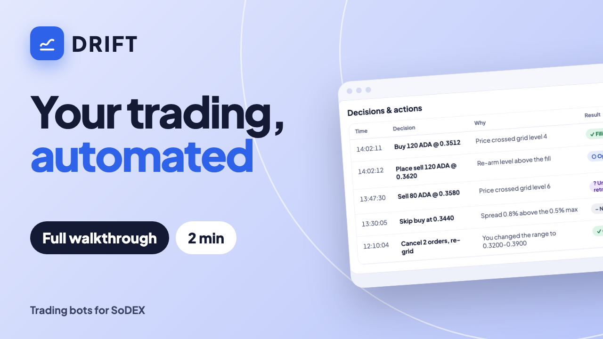

<div align="center">


# DRIFT

**Profit bots for SoDEX. Your trading, studied. Then automated.**

DRIFT reads how you already trade on [SoDEX](https://sodex.com), suggests a strategy that fits your own history,
and runs it for you on mainnet. It trades; it never moves your money.




</div>

> ⚠️ **Every bot trades real funds on SoDEX mainnet.** Automated trading can lose money; DRIFT doesn't guarantee
> profit. Backtests are simulations, not forecasts. Not financial advice. Read the
> Risk Disclosure at `/risk-disclosure` before you start a bot.

---

## 📑 Contents

- [✨ What DRIFT does](#-what-drift-does)
- [🔐 Product rules](#-product-rules)
- [🗺️ User journey](#️-user-journey)
- [🤖 Strategies](#-strategies)
- [🏗️ System architecture](#️-system-architecture)
- [🧩 Services](#-services)
- [⚙️ How correctness is kept](#️-how-correctness-is-kept)
- [🔑 Signing & key security](#-signing--key-security)
- [🔄 Bot lifecycle](#-bot-lifecycle)
- [📨 Main flows](#-main-flows)
- [🧠 Recommendation engine & AI parameters](#-recommendation-engine--ai-parameters)
- [📈 Backtest](#-backtest)
- [🛡️ Risk & controls](#️-risk--controls)
- [💸 Fees](#-fees)
- [🧰 Tech stack](#-tech-stack)
- [📁 Repository layout](#-repository-layout)
- [🚀 Getting started (dev)](#-getting-started-dev)
- [🌐 Deploy to a server](#-deploy-to-a-server)
- [✅ Testing](#-testing)
- [📚 Documentation](#-documentation)

---

## ✨ What DRIFT does

|                               |                                                                                                                 |
| ----------------------------- | --------------------------------------------------------------------------------------------------------------- |
| 🔗 **Connect in your wallet** | Approve two sign requests from your SoDEX wallet. No gas, no funds moved, nothing to copy or paste.             |
| 📥 **Studies your history**   | Imports your SoDEX trades, fills, funding and positions automatically and shows where your profit really went.  |
| 🎯 **Suggests a plan**        | A deterministic engine matches strategies and parameters to your data and goals, and explains every suggestion. |
| 🧪 **Backtests first**        | Replays the same settings over SoDEX price history with fees included.                                          |
| 🤖 **Runs the bot**           | 8 strategies on Spot and Perps, live on mainnet, with every decision logged in the Trading Agent.               |
| 🛡️ **Keeps you in control**   | Server-enforced risk limits, pause / edit / stop anytime, one-tap Halt all agents.                              |

---

## 🔐 Product rules

These are non-negotiable and enforced in code (see [`CLAUDE.md`](CLAUDE.md) §1):

1. **Trading only.** No withdrawal or transfer feature, endpoint or code path. The key DRIFT holds has withdraw and transfer turned off.
2. **Live only (v1).** Every bot runs on SoDEX mainnet. Paper trading shows as "Coming soon" and is not built.
3. **Connect with wallet signatures.** The SoDEX master wallet signs; the user never pastes a key or secret.
4. **One fixed builder fee: 0.01%** (`maxFeeRate = 10`). Approve or revoke only.
5. **Revoking the fee pauses every bot** of that account. Open orders stay as they are.
6. **State comes from the backend**, not from the button: `Starting…`, `Pausing…`, `Applying v4…` until SoDEX confirms.
7. **No blind retries.** An order with an unclear result is marked `unknown` and reconciled with SoDEX before anything is resent.
8. **No invented numbers.** Missing data shows "Not available", never `0`. No profit forecasts.
9. **No secret leaks.** Keys show only their last 4 characters; secrets never reach logs, errors or analytics.
10. **DRIFT never asks for a seed phrase or private key.**

---

## 🗺️ User journey

```
 Sign up ─▶ Connect SoDEX ─▶ Import history ─▶ Account analysis ─▶ Your goals ─▶ Strategy plan
 (email +    (2 wallet sign    (automatic:       (fees, funding,     (goal, capital,  (strategies that
  password)   requests)         trades, fills,    holding time,       max drop,        fit your data,
                                funding)          leverage)           markets)         with reasons)
                                                                                            │
     ┌──────────────────────────────────────────────────────────────────────────────────────┘
     ▼
 Create bot ─▶ Backtest ─▶ Before it starts ─▶ Start on mainnet ─▶ Trading Agent ─▶ Pause · Edit vN · Stop
 (AI params,   (SoDEX       (connection, fee,    (checkbox + 2FA)    (every decision,
  every field   history,     balance, min size,                       why, and what
  editable)     fees in)     2FA, risk, leverage)                     SoDEX said)
```

| Route                                            | Screen                                                                               |
| ------------------------------------------------ | ------------------------------------------------------------------------------------ |
| `/`                                              | Landing (signed out) · Overview (signed in)                                          |
| `/signup`, `/signin`                             | Email + password (2FA asked on sign-in when enabled)                                 |
| `/onboarding/*`                                  | Connect · Import · Analysis · Goals · Plan                                           |
| `/bots`, `/bots/new/:strategy`, `/bots/:id/edit` | Strategy Lab: list, create, edit                                                     |
| `/agent/:botId`                                  | Trading Agent: status, decisions, orders, errors, controls                           |
| `/portfolio`, `/orders`, `/risk`, `/analyst`     | Portfolio · Execution & Orders · Risk Center · AI Analyst                            |
| `/settings`                                      | SoDEX access · Security (2FA, sessions) · Notifications · Trading defaults · Profile |
| `/admin/*`                                       | Builder Revenue · Users (role `team` only)                                           |
| `/risk-disclosure`                               | Public risk disclosure                                                               |

Desktop and mobile share the same routes; below 1024 px the sidebar becomes a bottom nav.

---

## 🤖 Strategies

| Key             | Strategy          | Engine        | What it does                                                      | Builder fee on              |
| --------------- | ----------------- | ------------- | ----------------------------------------------------------------- | --------------------------- |
| `spot_grid`     | Spot Grid         | Spot          | Buys low and sells high inside a range you set                    | sells                       |
| `futures_grid`  | Futures Grid      | Perps         | Grid on a perpetual: long, short or neutral                       | both sides                  |
| `spot_dca`      | Spot DCA          | Spot          | Buys, adds safety orders on dips, sells everything at take profit | sells                       |
| `futures_dca`   | Futures DCA       | Perps         | DCA on a perpetual, long or short                                 | both sides                  |
| `recurring_buy` | Recurring Buy     | Spot          | Buys a fixed amount on a schedule. Never sells                    | none                        |
| `rebalancing`   | Rebalancing       | Spot          | Keeps 2–10 assets at target weights                               | sells                       |
| `funding_arb`   | Funding Arbitrage | Spot + Perps  | Holds spot and an equal perp short to collect funding             | perp both sides, spot sells |
| `twap`          | TWAP              | Spot or Perps | Splits one large order into small slices over time                | per engine                  |
| `volume_maker`  | Volume Maker      | Perps         | Post-only two-sided quotes with a cost cap and self-trade guard   | maker fills                 |

> `volume_maker` is coded but locked behind `VOLUME_MAKER_ENABLED=false` until SoDEX confirms it in writing
> ([`docs/VOLUME_MAKER.md`](docs/VOLUME_MAKER.md)).

Strategy logic lives only in [`packages/strategies`](packages/strategies) as **pure `step` functions** (no I/O). The
engine, the backtester and the unit tests all run the same code, so a backtest and a live bot make the same decisions
on the same candles.

---

## 🏗️ System architecture

```
 Browser ──HTTPS──▶ traefik ──▶ web (Next.js)               [stateless, N replicas]
  (wallet:                ├──▶ api  (REST, Fastify)          [stateless, N replicas] ──┐
   wagmi/viem)            └──▶ realtime (WebSocket)          [stateless, N replicas]   │
                                                                                       │
 ┌──────────────────────────────── core network ─────────────────────────────────────┤
 │  engine ×N    bot workers; each owns a set of account shards (lease + epoch)       │
 │  marketdata   1 active + standby; SoDEX market WS ─▶ NATS md.<market>.*, candles   │
 │  scheduler    1 active + standby; cron (daily reset, key expiry, market stats)     │
 │  jobs ×N      history import, analysis, unknown-order reconcile, revenue, notify   │
 │  reco ×N      recommendation engine + AI parameters (deterministic)                │
 │  backtest ×N  simulation workers (CPU heavy)                                       │
 │                                                                                    │
 │  NATS JetStream (events + work queues) · Redis (leases, cache, rate limits)        │
 │  PostgreSQL 16 + TimescaleDB (through PgBouncer, transaction pooling)              │
 └────────────────────────────────────────────────────────────────────────────────────┘
 ┌────────── secure network (internal, no Internet) ──────────┐
 │  signer ×2  decrypts DRIFT's SoDEX key in memory, signs     │ ◀── mTLS; only api and engine
 │  Vault      transit key `drift-api-keys` (envelope crypto)  │     can call it
 └─────────────────────────────────────────────────────────────┘
 engine / marketdata / jobs ──HTTPS / WSS──▶ SoDEX mainnet gateway
```

Everything runs with `docker compose` (dev, staging, single-host production). Scaling is adding replicas, e.g.
`docker compose up -d --scale engine=6 --scale backtest=4 --scale api=3`. Past one host, the same images move to
Kubernetes.

---

## 🧩 Services

| Service      | Role                                                                                    | State                      | Scale                      |
| ------------ | --------------------------------------------------------------------------------------- | -------------------------- | -------------------------- |
| `web`        | Next.js App Router UI, desktop + mobile                                                 | stateless                  | replicas                   |
| `api`        | REST: auth, bots, settings, SoDEX connect, jobs                                         | stateless                  | replicas                   |
| `realtime`   | Pushes `user.<accountId>.*` events from NATS to the browser                             | stateless                  | replicas                   |
| `engine`     | Runs bot logic, holds the SoDEX user stream for owned accounts, sends orders            | shard lease                | replicas, shards rebalance |
| `signer`     | Decrypts DRIFT's key via Vault transit, signs payloads, audits                          | stateless, key only in RAM | 2+                         |
| `marketdata` | Only process with a market WS; publishes prices / klines / funding, stores `candles_1m` | leader lease               | 1 active                   |
| `scheduler`  | Cron jobs: daily loss reset, key expiry reminders, `market_stats_daily`                 | leader lease               | 1 active                   |
| `jobs`       | Import, analysis, reconcile `unknown`, builder revenue, notifications                   | consumer group             | replicas                   |
| `reco`       | Strategy plan + AI parameters                                                           | stateless + cache          | replicas                   |
| `backtest`   | Simulation worker on JetStream `backtest.run`                                           | consumer group             | replicas                   |
| `postgres`   | Main data + Timescale hypertable for candles                                            | stateful                   | primary (+ replica later)  |
| `pgbouncer`  | Connection pooling                                                                      | stateless                  | 1–2                        |
| `redis`      | Leases, rate limits, cache, latest prices                                               | stateful                   | 1 (Sentinel later)         |
| `nats`       | JetStream event bus + work queues                                                       | stateful                   | 1 → 3-node cluster         |
| `vault`      | Transit encryption for keys                                                             | stateful                   | 1 (KMS / cluster later)    |
| `traefik`    | TLS (Let's Encrypt), routing `/`, `/api`, `/ws`                                         | stateless                  | 1                          |

---

## ⚙️ How correctness is kept

| Concern                          | Mechanism                                                                                                                                                            |
| -------------------------------- | -------------------------------------------------------------------------------------------------------------------------------------------------------------------- |
| **One writer per SoDEX account** | Accounts map to 64 virtual shards (`FNV-1a(accountId) % 64`). Each engine holds Redis leases for its shards; a dead worker's lease expires and another takes over.   |
| **No zombie writers**            | Taking a shard bumps its `epoch` in Postgres. Every write checks the epoch; the signer refuses requests with an old epoch.                                           |
| **No duplicate orders**          | Deterministic `clOrdID` = hash(bot, config version, level/cycle, attempt) with a unique index per account. Every state-changing API call needs an `Idempotency-Key`. |
| **Unclear results**              | Orders are written as `unknown` _before_ sending. Reconciled against open orders + history; never resent until known (`filled` / `open` / `not_placed`).             |
| **Reliable events**              | Outbox pattern: state change and event in one transaction; a relay publishes to NATS.                                                                                |
| **Jobs**                         | JetStream work queues, ack after done, backoff 1s / 5s / 30s / 2m / 10m, then DLQ.                                                                                   |
| **SoDEX limits**                 | Redis token buckets per key / IP / address. Each IP holds user streams for about 10 accounts.                                                                        |
| **Self-trading**                 | Engine blocks any limit order that would cross the account's own resting orders (`SELF_TRADE_BLOCKED`).                                                              |
| **Shared leverage**              | SoDEX leverage is per account + market; a bot never changes it under an open position (`leverage_conflict` check).                                                   |
| **Graceful shutdown**            | SIGTERM: stop taking work, release leases, finish in-flight requests (30 s grace).                                                                                   |

---

## 🔑 Signing & key security

```
                  ┌──────────── user's browser ─────────────┐
                  │  SoDEX master wallet (EIP-712)           │
                  │   ① add DRIFT API key  (withdraw +       │
                  │      transfer turned off)                │
                  │   ② approve builder fee 0.01%            │
                  └──────────────┬───────────────────────────┘
                                 │ signatures only
                                 ▼
  api ──mTLS──▶ signer ──▶ Vault transit (encrypt)  ──▶ Postgres stores ciphertext only
                  ▲
  engine ─mTLS────┘  sends {accountId, payloadHash, epoch} ─▶ gets a signature back
```

- DRIFT generates its own trading key; the private part is envelope-encrypted with Vault transit and decrypted only inside `signer`, in memory.
- `signer` sits on an internal network. Client certificates decide what each caller may do (`api` → keys, `engine` → sign).
- Users sign in with **email + password** (scrypt, 15-minute lock after 5 failures). **2FA (TOTP) is required** before any bot can trade on mainnet, and again to start or stop a bot.
- Strict CSP with a per-request nonce, `frame-ancestors 'none'`, CSRF token on writes, rate limits per IP and per user.

---

## 🔄 Bot lifecycle

```
             Start (checkbox + 2FA)
   draft ───────────────────────────▶ starting ──SoDEX ack──▶ running ◀──────────┐
     │                                                     │    ▲               │
   Delete                                            Pause │    │ Resume         │ Apply edit vN
                                                           ▼    │ (reason gone)  │ (diff dialog)
                                                       pausing ─▶ paused ────────┘
                                                           │
                                running / paused ── Stop (2FA) ──▶ stopping ──▶ stopped ──▶ archived
```

| Reason code                                 | Result  | Scope    | Resumes when                                 |
| ------------------------------------------- | ------- | -------- | -------------------------------------------- |
| `BUILDER_FEE_REVOKED`                       | paused  | all bots | fee approved again, then each bot resumed    |
| `API_KEY_EXPIRED` / `API_KEY_UNUSABLE`      | paused  | all bots | SoDEX reconnected (sign again)               |
| `RISK_DAILY_LOSS`                           | paused  | all bots | daily reset at 00:00 in the user's time zone |
| `BOT_MAX_LOSS`                              | paused  | one bot  | max loss raised in Edit                      |
| `ORDER_REJECTED` / `INSUFFICIENT_BALANCE`   | paused  | one bot  | cause fixed, user resumes                    |
| `STOP_LOSS` / `TAKE_PROFIT` / `BUDGET_DONE` | stopped | one bot  | —                                            |
| `EMERGENCY_HALT`                            | stopped | all bots | —                                            |

`paused` keeps open orders; `stopped` cancels them and runs the bot's end action. A grid outside its range stays
`running` with a "Needs attention" flag.

---

## 📨 Main flows

```
Start bot   api (zod) ─▶ bot=starting + outbox ─▶ engine (owner shard) ─▶ signer ─▶ SoDEX
                                        SoDEX ack ─▶ bot=running ─▶ NATS user.<id>.bot ─▶ realtime ─▶ UI

Fill        SoDEX user stream ─▶ engine: order + bot state, builderFee ─▶ NATS ─▶ UI

Unknown     engine marks unknown ─▶ jobs reconcile (open orders + fills) ─▶ filled / open / not_placed
                                                                     └─▶ only then can the bot act again

Revoke fee  user signs maxFeeRate 0 ─▶ jobs read approval back ─▶ engine pauses every bot (BUILDER_FEE_REVOKED)

Backtest    api creates job ─▶ JetStream backtest.run ─▶ backtest worker ─▶ result cached by
            (strategy, market, config hash, period, data version) ─▶ progress via realtime
```

---

## 🧠 Recommendation engine & AI parameters

`reco` is **deterministic**: the same inputs give the same output, and every number traces back to an input. Any
LLM wording may only rephrase reasons; it never creates numbers.

| Input            | From                                                                                                                                |
| ---------------- | ----------------------------------------------------------------------------------------------------------------------------------- |
| Account analysis | net PnL / win rate / volume share per market, fees vs gross PnL, taker ratio, PnL by holding time, losses by leverage, max drawdown |
| Goals            | goal (automate / range / accumulate / steady), capital, max drop (5 / 10 / 20%), markets                                            |
| Market stats     | 30-day daily volatility, price percentiles P5 / P50 / P95, last + mark price, funding                                               |

Output: ranked strategies with reasons and "what we didn't suggest", plus a full parameter set for the Create
screen ("✦ AI parameters" ↔ "Clear parameters"). Thresholds live in
[`packages/shared/src/reco/config.ts`](packages/shared/src/reco); golden-file tests lock the behaviour.

---

## 📈 Backtest

- Same `packages/strategies` code as the live engine; a test asserts the engine and the backtest produce the same order sequence on the same candles.
- Candle path O→L→H→C (up candle) / O→H→L→C (down candle); orders placed in a candle can't fill in that candle; market orders fill at the next open ± 0.05% slippage.
- SoDEX base fees + DRIFT builder fee; perps include recorded funding.
- Interval by period: 30D → 5m, 90D → 15m, 180D → 1h (what SoDEX keeps), 1m when DRIFT's own `candles_1m` cover the period.
- Measured: 90 days of 1m candles ≈ 12 s; real data 90D / 15m ≈ 4.4 s.

---

## 🛡️ Risk & controls

| Limit                                        | Enforced by                                                    |
| -------------------------------------------- | -------------------------------------------------------------- |
| Daily loss (% of equity, resets 00:00 local) | server: risk engine pauses all bots                            |
| Max drawdown 30D                             | server                                                         |
| Per-trade risk (% of equity)                 | server: orders past it are blocked                             |
| Max leverage, open positions                 | UI warning                                                     |
| Per-bot max loss, stop price, take profit    | engine, per bot                                                |
| **Halt all agents**                          | stops every bot and cancels their open orders, from any screen |

---

## 💸 Fees

- **Builder fee 0.01%** on fills of orders DRIFT sends, collected by SoDEX through Builder Codes and shown inside each fill's fee. Which side pays depends on the strategy (table above).
- SoDEX trading fees and funding apply as usual.
- The builder's own SoDEX account pays no builder fee to itself.
- Builder revenue is reconciled daily: `builderFee` on fills vs the builder balance change; unexplained differences stay _pending_.

---

## 🧰 Tech stack

| Layer     | Choice                                                                                          |
| --------- | ----------------------------------------------------------------------------------------------- |
| Monorepo  | pnpm workspaces + Turborepo, TypeScript `strict` everywhere                                     |
| Web       | Next.js 16 (App Router), React 19, Tailwind CSS 4 with design tokens, TanStack Query, next-intl |
| Wallet    | wagmi + viem (EIP-712 `signTypedData`), WalletConnect (optional Project ID)                     |
| API       | Fastify 5, zod at every boundary, Drizzle ORM                                                   |
| Money     | `decimal.js` / integer units — never floats                                                     |
| Data      | PostgreSQL 16 + TimescaleDB, PgBouncer, Redis 7                                                 |
| Messaging | NATS JetStream (events, work queues, DLQ)                                                       |
| Secrets   | HashiCorp Vault transit (cloud KMS later), mTLS between services                                |
| Edge      | Traefik 3.6, Let's Encrypt                                                                      |
| Tests     | Vitest (+ Testcontainers for Postgres), Playwright e2e with a SoDEX mock, axe a11y checks       |

---

## 📁 Repository layout

```
drift/
├── apps/
│   ├── web/          Next.js UI (features/, components/, messages/en.json)
│   ├── api/          Fastify REST (modules/auth, bots, sodex, account, risk, …)
│   ├── realtime/     WebSocket fan-out from NATS
│   ├── engine/       bot workers, shard leases, order lifecycle
│   ├── signer/       key decryption + signing (internal network)
│   ├── marketdata/   SoDEX market WS → NATS + candles
│   ├── scheduler/    cron jobs
│   ├── jobs/         import, analysis, reconcile, revenue, notifications
│   ├── reco/         recommendation engine + AI parameters
│   └── backtest/     simulation worker
├── packages/
│   ├── shared/       enums, zod schemas, error codes, money helpers, reco config
│   ├── strategies/   pure strategy step functions + backtest core
│   ├── sodex/        SoDEX REST/WS client, EIP-712 signing, rate limits
│   ├── db/           Drizzle schema, migrations, client
│   ├── runtime/      leases, JetStream helpers, mTLS
│   └── ui/           design tokens + shared components (Storybook)
├── e2e/              Playwright flows + SoDEX mock server
├── infra/            postgres init, vault config, certs, deploy scripts
├── deploy/server/    single-file production compose + .env example
├── docs/             architecture, domain, strategies, screens, decisions…
└── docker-compose.yml
```

---

## 🚀 Getting started (dev)

Requirements: Node 22, pnpm (via corepack), Docker.

```bash
corepack enable
pnpm install
cp .env.example .env          # fill POSTGRES_PASSWORD, SIGNER_DB_PASSWORD, API_TOTP_ENC_KEY, DRIFT_BUILDER_ID, …
infra/certs/gen-dev-certs.sh infra/certs/dev
docker compose --profile dev --profile app up -d --build
docker compose --profile app run --rm migrate
```

Open `http://localhost`. Dev uses Mailpit for email (`http://localhost:8025`) and SoDEX **mainnet** for reads;
automated tests sign and send against a mock server.

```bash
pnpm lint && pnpm typecheck && pnpm test     # what CI runs
pnpm e2e                                     # Playwright flows
```

---

## 🌐 Deploy to a server

A single-host deploy needs only two files from [`deploy/server/`](deploy/server): `docker-compose.yml` and `.env`.
The first `up` creates the mTLS certificates, initialises and unseals Vault, and runs migrations.

```bash
# on your machine: build and push all images (amd64 by default, PLATFORM=linux/arm64 for ARM servers)
infra/deploy/build-push.sh

# on the server
docker login -u <docker-hub-user>          # read-only token
cp .env.example .env && nano .env          # domain, secrets, DRIFT_TAG
docker compose up -d
docker compose exec vault-init cat /vault/init/init.txt   # copy the unseal key off the server
```

Minimum server: 2 vCPU, 4 GB RAM, 40–80 GB disk. Point the domain's A record straight at the server (no proxy) so
Let's Encrypt can issue the certificate. Details, backups and rollbacks: [`docs/DEPLOY.md`](docs/DEPLOY.md).

---

## ✅ Testing

| Layer    | What is covered                                                                                                                                    |
| -------- | -------------------------------------------------------------------------------------------------------------------------------------------------- |
| Unit     | money helpers, every strategy (start, fill, stop, take profit, max loss, order errors), state machine, reco golden files, risk, leverage conflicts |
| API      | real Postgres via Testcontainers: auth (password, 2FA, lockout), bots, SoDEX connect, account, rate limits                                         |
| Engine   | shard handover without duplicate orders, unknown → reconcile, fee revoke pauses bots                                                               |
| Backtest | engine and backtest produce identical orders on the same fixture                                                                                   |
| E2E      | sign up → connect (two signatures) → 2FA → create → start → pause / resume → edit → stop                                                           |
| A11y     | axe (serious / critical) and no horizontal scroll at 1440 and 390 px                                                                               |

---

## 📚 Documentation

| File                                                                                      | Read when                                                |
| ----------------------------------------------------------------------------------------- | -------------------------------------------------------- |
| [`CLAUDE.md`](CLAUDE.md)                                                                  | always: product rules, glossary, how to work in the repo |
| [`docs/ARCHITECTURE.md`](docs/ARCHITECTURE.md)                                            | services, compose, queues, scaling                       |
| [`docs/SODEX.md`](docs/SODEX.md)                                                          | signing, orders, fees, builder revenue                   |
| [`docs/DOMAIN.md`](docs/DOMAIN.md)                                                        | models, state machines, DB schema                        |
| [`docs/STRATEGIES.md`](docs/STRATEGIES.md)                                                | full field spec of each strategy                         |
| [`docs/SCREENS.md`](docs/SCREENS.md) · [`docs/DESIGN.md`](docs/DESIGN.md)                 | every screen, design tokens, accessibility               |
| [`docs/RECO_ENGINE.md`](docs/RECO_ENGINE.md) · [`docs/BACKTEST.md`](docs/BACKTEST.md)     | recommendation engine, backtest model                    |
| [`docs/DEPLOY.md`](docs/DEPLOY.md) · [`docs/SECURITY_REVIEW.md`](docs/SECURITY_REVIEW.md) | production, backups, security checklist                  |
| [`docs/DECISIONS.md`](docs/DECISIONS.md)                                                  | every decision with its date (`DEC-xx`)                  |

---

<div align="center">

**DRIFT trades. It never moves your money.**

<sub>Automated trading can lose money; DRIFT doesn't guarantee profit. Not financial advice.</sub>

</div>
